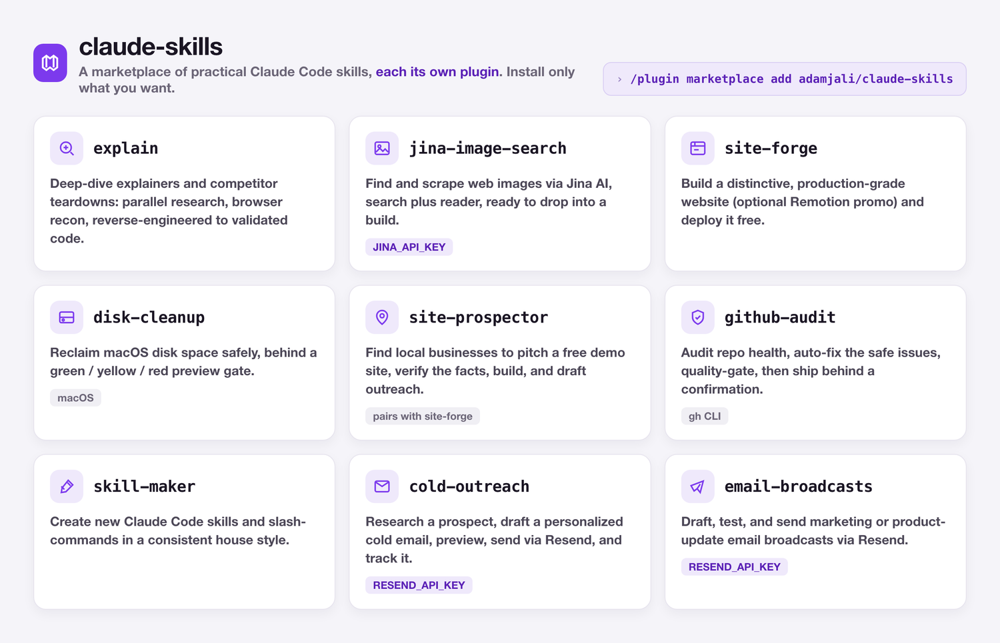
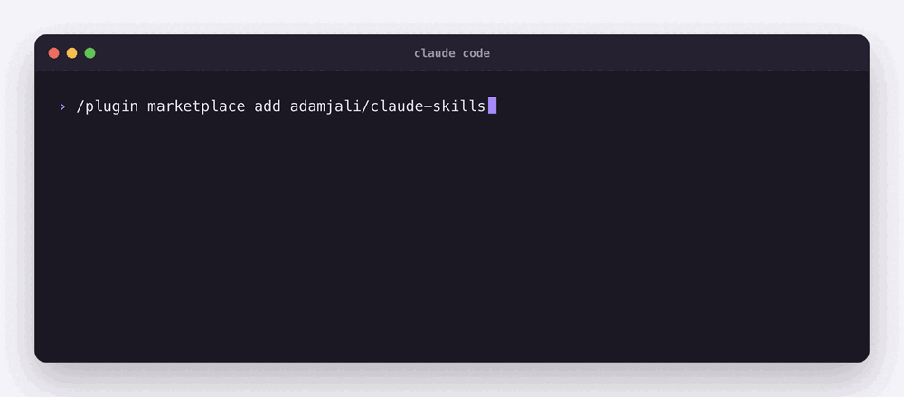
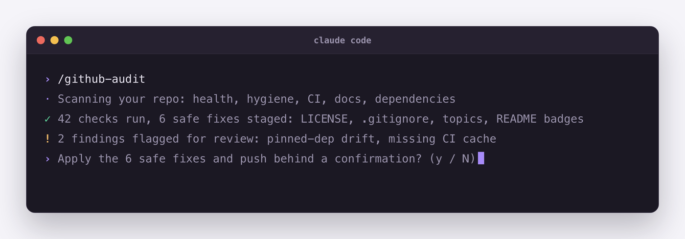

# claude-skills

Practical [Claude Code](https://code.claude.com) skills, each one a plugin you can install on its own.



## Install

In Claude Code:

```text
/plugin marketplace add adam-j-ali/claude-skills
/plugin install explain@adamjali
```

Swap `explain` for any skill below. Then ask for what you want, or run the skill by name (`/explain`).



## Skills

| Skill | What it does | Needs |
|-------|--------------|-------|
| `explain` | Deep dives and competitor teardowns | nothing |
| `jina-image-search` | Find images on the web | `JINA_API_KEY` (optional for reads) |
| `site-forge` | Build a website and deploy it free | optional: `JINA_API_KEY`, a deploy CLI |
| `disk-cleanup` | Free up disk space on a Mac | macOS |
| `site-prospector` | Find local businesses to pitch a demo site | `site-forge` |
| `github-audit` | Check and fix a repo's health | `gh` CLI |
| `skill-maker` | Make new Claude Code skills | nothing |
| `cold-outreach` | Research a prospect and send a cold email | `RESEND_API_KEY` |
| `email-broadcasts` | Send product-update emails | `RESEND_API_KEY` |

## Keys

Add the keys you need to your shell profile:

```bash
export JINA_API_KEY="your-key"     # free key at https://jina.ai
export RESEND_API_KEY="your-key"   # free key at https://resend.com
```

## A skill at work



*An illustrative run of `github-audit`.*

## License

MIT. See [LICENSE](LICENSE).
